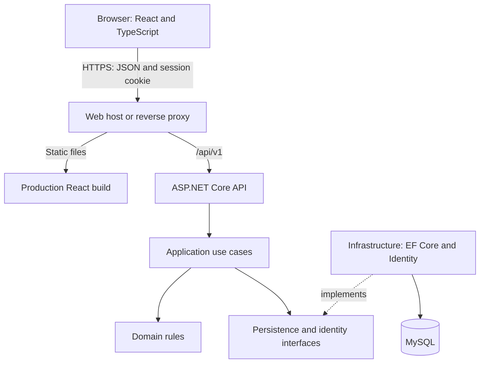

# TaskFlow architecture plan

Prepared: 18 October 2026. Status: adopted implementation baseline. Delivery step 01 is recorded in [the decision register](../docs/decisions/README.md); API and database amendments are authoritative for the explicitly refined contracts.

## Document review

Reviewed all seven Word documents in this folder. The workspace now contains the user's TaskFlow-FE and TaskFlow-BE starter projects and a root TaskFlow.slnx. See [setup-review.md](../docs/setup-review.md) for verified builds and remaining prerequisites.

| Source | Role in this plan |
| --- | --- |
| BRD- TaskFlow.docx | Business objectives, MVP scope, acceptance criteria |
| SRS - TaskFlow.docx | Required behavior, permissions, non-functional requirements |
| SAD - TaskFlow.docx | Layered monolith, project boundaries, deployment |
| ERD - TaskFlow.docx | Entities, constraints, indexes, unresolved retention choices |
| API Spec - TaskFlow.docx | Routes, DTOs, validation, pagination |
| Implementation Plan - TaskFlow.docx | Delivery phases and existing TF-001–TF-015 identifiers |
| Test Plan - TaskFlow.docx | Risk-based tests, MySQL integration, browser journeys |

The documents describe a consistent product, but some sections are drafts even where document headers say completed. The decisions below have been resolved by [ADRs 0001–0004](../docs/decisions/README.md), [API amendments](../docs/contracts/api-baseline.md), and [database amendments](../docs/contracts/database-baseline.md). Those records distinguish adopted rules from unimplemented behavior and explicitly supersede the affected draft examples.

## Product and scope

TaskFlow helps individuals and small teams manage private projects and their tasks. The MVP includes accounts, profile display-name editing, project CRUD, membership, task CRUD, assignment, priority, deadlines, search, filtering, sorting, pagination, project progress, dashboard totals, and activity history.

Defer comments, attachments, notifications, email invitations, Kanban drag-and-drop, real-time collaboration, AI features, payments, and advanced reporting. Although comments appear conditionally in the SRS, the ERD and implementation scope exclude them.

## System shape

Use the SAD's layered modular monolith: one API, one relational database, and one React application. Organize features within layers. No message broker, cache, background worker, or microservices are needed for the MVP.



The diagram shows runtime responsibilities. Compile-time dependencies are Domain ← Application ← Infrastructure, with Api referencing Application and Infrastructure to configure dependency injection. Domain must never reference Infrastructure.

| Boundary | Responsibility |
| --- | --- |
| React frontend | Pages, forms, routing, loading/error/empty states, local-time display |
| Api | HTTP contracts, middleware, authentication, authorization entry points, Problem Details, OpenAPI |
| Application | Use cases, resource permission checks, DTOs, transactions, activity coordination |
| Domain | Project/task invariants, status and priority values, business calculations |
| Infrastructure | EF mappings, MySQL queries and migrations, Identity, persistence implementations |

Use narrow application interfaces for persistence operations where needed. EF Core manages the unit of work; avoid generic repositories and a separate repository for every table. Controllers stay thin. Do not add a mediator, event bus, or CQRS framework unless actual complexity justifies it.

## Repository layout

```text
TaskFlow/
  Documents/                        # Original requirements and planning documents
  TaskFlow.slnx
  TaskFlow-BE/
    TaskFlow.Api/
    TaskFlow.Application/           # Feature use cases, DTOs, interfaces
    TaskFlow.Domain/                # Entities, enums, business rules
    TaskFlow.Infrastructure/        # Persistence, configurations, Identity
    TaskFlow.Tests/                 # Existing unit-test scaffold
  TaskFlow-FE/
    src/
      app/                          # Router, providers, application shell
      api/                          # Shared HTTP client and error handling
      components/                   # Shared controls
      features/                     # auth, projects, tasks, dashboard, activity, profile
    e2e/
  docs/decisions/                   # Accepted architecture decisions
  README.md
```

Create folders as needed. Keep feature-specific UI, types, and API calls together. Retain the installed React Router and Axios for a centralized HTTP client, with component state/context initially. Add a separate integration-test project when its fixtures are introduced. Keep the user's directory names. Runtime/provider selection is resolved in ADR 0004: EF Core/Identity 10.0.11 and Oracle MySql.EntityFrameworkCore 10.0.9 on net10.0. See the toolchain guide for pins and database-setup.md for completed live-server verification.

## Authentication and hosting baseline

Use ASP.NET Core Identity with one authoritative application user record. Recommend secure HttpOnly cookie authentication for this browser application. Host the frontend and `/api` under one public origin through the API host or a reverse proxy; frontend and backend remain independently built. This simplifies cookie behavior compared with unrelated hosting domains.

Use a development proxy for API calls. Require HTTPS in production, Secure cookies, SameSite=Lax, an explicit session expiry, and CSRF validation for state-changing requests, including login/register/logout. Add a small CSRF-token bootstrap contract before the frontend auth work. Configure API authentication failures as JSON 401/403 responses rather than HTML redirects. Rate-limit authentication endpoints and enable Identity lockout.

Login returns the profile and establishes the cookie; do not also return bearer tokens. Logout clears authentication and invalidates the session through a server-validated session/security-stamp mechanism; test replay of the previous cookie. Persist data-protection keys for hosted restarts. Keep secrets outside source control and logs.

Email confirmation, password recovery, and email/password editing are deferred for the demonstration MVP; do not display accounts as email-verified. Reassess these flows before broader public use. Hosting provider and spending decisions remain open.

## Permissions and ownership baseline

Start with Owner and Member. Defer the optional Admin role because the SRS only establishes owner/member behavior and the API has no role-update endpoint. `Projects.OwnerId` is the authoritative owner; store only non-owner members in `ProjectMembers` with role Member. The members response synthesizes an Owner entry. This avoids two writable sources of ownership.

| Operation | Owner | Member | Other authenticated user |
| --- | --- | --- | --- |
| Create a new project | Yes | Yes | Yes |
| View project, tasks, members, activity | Yes | Yes | No |
| Edit project settings | Yes | No | No |
| Delete project | Yes | No | No |
| Add/remove members | Yes | No | No |
| Create/edit/assign tasks; change status | Yes | Yes | No |
| Delete tasks | Yes | No | No |

All authenticated users can manage their own profile. No global administrator is required. Owners are eligible assignees. Adding the owner as a member is a conflict; removing the owner is rejected. Ownership transfer and self-service leave are deferred.

Check permissions on the server for every request, including direct task-ID requests and aggregate queries. Return 404 for resources outside the caller's visible projects; return 403 when a visible project's operation is forbidden. Derive actor and owner IDs from authentication. Membership removal takes effect on the next request; do not cache membership in long-lived auth claims.

## Data and transaction rules

| Entity | Key and relationships | Important rules |
| --- | --- | --- |
| ApplicationUser | Identity user with numeric key | Unique normalized email; display name ≤100; Identity owns credentials |
| Project | Id; OwnerId → user | Name ≤150; optional description; UTC timestamps |
| ProjectMember | Composite ProjectId + UserId | Role Member; duplicate and owner membership rejected |
| TaskItem | Id; ProjectId; nullable AssigneeId | Title ≤200; status ToDo/InProgress/Done; priority Low/Medium/High |
| ActivityLog | Id; ProjectId; ActorUserId; optional TaskId | Backend-created, append-only, timestamped event |

Keep signed BIGINT key types consistent throughout Identity and foreign keys. Serialize IDs as positive decimal strings in JSON and TypeScript; validate the signed BIGINT range. This supersedes numeric ID examples in the Word API specification, as recorded in the API amendments.

Use a 10,000-character limit for project/task descriptions, documented and enforced by both server and UI. Store enum names explicitly. Database constraints enforce primary/foreign keys and email/membership uniqueness; application rules enforce eligible assignment and permissions.

Retention policy: soft-delete projects and tasks with nullable DeletedAtUtc. Hide deleted records from ordinary lists, detail reads, activity access through deleted projects, dashboard counts, and assignment operations. Preserve memberships and activity internally; no restore or purge endpoint in the MVP. Project deletion hides its tasks through project visibility rather than updating every task. Use explicit restrictive foreign keys; no accidental history cascades. Account deletion is deferred. The two additional columns are recorded in ADR 0002 and the database amendment.

Removing a member unassigns that user's active tasks in the project in the same transaction and records the removal/assignment events. Serialize membership changes and assignment operations for the same project so a concurrent request cannot assign a removed user. Project/task mutations and their activity entries commit or roll back together. Introduce activity persistence with the first project mutation, even though its reader UI comes later.

Index owner lookup, membership (UserId, ProjectId), tasks (ProjectId, Status), tasks (ProjectId, DueDateUtc), task AssigneeId, and activity (ProjectId, CreatedAtUtc, Id). Review indexes against actual queries. MySQL DATETIME(6) values are treated as UTC by the application.

## API and calculation decisions

Preserve the supplied `/api/v1` routes for auth, projects, members, tasks, dashboard, project activity, and `users/me`. Add only documented contracts needed for CSRF and project progress. A project-detail DTO should include totalTasks, completedTasks, and progressPercentage, which are required by the SRS but absent from the API examples.

- Status wire values: ToDo, InProgress, Done. UI labels: To Do, In Progress, Completed. New tasks always start ToDo. All transitions among supported values are allowed; no workflow restrictions are specified.
- PATCH: omitted fields stay unchanged; explicit null clears optional description, assignee, or deadline. Null for a required field fails validation. Implement presence-aware DTO parsing. Status changes use the dedicated endpoint. Reject attempts to modify server-managed fields.
- Due dates represent instants: use a date-and-time input, submit UTC, display local time. Past deadlines are allowed. Overdue means DueDateUtc < current UTC time and status != Done. A deadline equal to now is not yet overdue. This resolves the source documents' date-versus-timestamp ambiguity.
- Progress = completed active tasks / all active tasks ×100, rounded to the nearest integer with .5 rounded upward; no tasks means 0%.
- Dashboard counts include each accessible active project/task once, including memberships, with assignedToMe limited to that same scope. No cached counters initially.
- Pagination defaults to page 1, pageSize 20, maximum 100. Invalid values return 400. Out-of-range pages return empty items with actual totals. Apply authorization before search/count/pagination.
- Default project/task order: createdAtUtc descending, then Id descending. Activity: createdAtUtc descending, then Id descending. Sort fields are allowlisted; priority uses Low < Medium < High rather than lexical order. Null deadlines sort last. Task title search is project-scoped; use deterministic tie-breakers for every sort.
- Return DTOs and consistent Problem Details with traceId. Include 429 in the auth contract. Preserve 201/Location and 204 semantics from the API specification.

## Verification and delivery

Use xUnit for rules, WebApplicationFactory with an isolated real MySQL database for API/persistence tests, Vitest/React Testing Library for important UI interactions, and Playwright for the critical journeys in the Test Plan. Add checks with each feature. Prioritize cross-user access, role restrictions, assignment/removal races, deletion visibility, CSRF, logout, constraints, and transactional activity.

Run backend build/tests, frontend type checks/tests/build, and database migration checks in CI early. Run browser journeys once complete flows exist. The SRS's two-second target applies to normal demonstration conditions, excluding cold starts/network latency; measure representative queries before introducing caching.

Deploy a minimal shell early to prove HTTPS, SPA deep links, `/api` routing, MySQL connectivity, cookie/CSRF behavior, and persisted keys. Hosting publication and costs are later execution decisions. Apply migrations deliberately, keep the database private, provide health/readiness checks, and document backup/recovery and environment configuration for release.

See [Delivery-Backlog.md](Delivery-Backlog.md) for the exact work order and acceptance gates.
