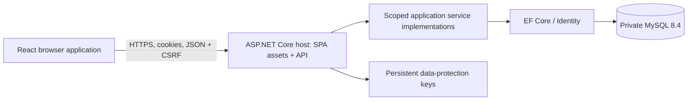
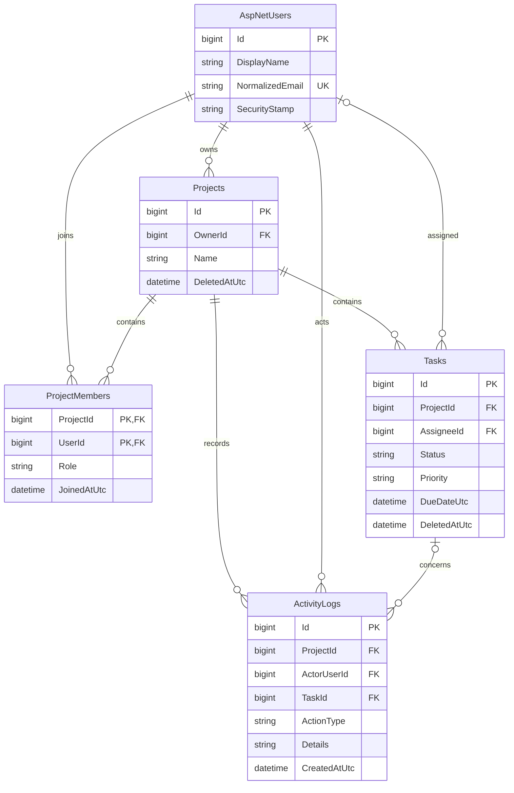

# Accepted implementation architecture and ERD

As built at step 23, 18 October 2026. This document describes the accepted implementation; the [original plan](../Documents/Architecture-Plan.md) retains planning history. [Decision records](decisions/README.md) and contract amendments govern deliberate changes to the Word specifications.

## Runtime

Production is one API process serving the compiled SPA and /api/v1. Development supports Vite HTTP or HTTPS proxies with matching API schemes. [Transport policy](transport.md) selects strict HTTPS or HTTP-compatible cookies; cookies remain HttpOnly and HTTPS requests receive Secure cookies; the client keeps CSRF tokens in memory and obtains a fresh token across identity changes. Logout rotates the user's security stamp and invalidates all device sessions. No worker, broker or cache is required. No arbitrary forwarded headers are trusted; a hosting proxy must preserve HTTPS to the API or receive an explicitly reviewed forwarding policy.

## Code boundaries

| Project / directory | Responsibility |
| --- | --- |
| TaskFlow.Domain | Entities, enums and text rules; no persistence or HTTP dependencies |
| TaskFlow.Application | Use-case interfaces, DTO contracts, policy and shared result semantics |
| TaskFlow.Infrastructure | EF mappings/migrations, Identity user store, concrete use-case services, queries and transactions |
| TaskFlow.Api | Controllers, transport validation, authentication/CSRF, errors, health, logging and dependency composition |
| TaskFlow.Tests | Policy, HTTP, provider, persistence, deployment and concurrency verification |
| TaskFlow-FE/src/api | Central Axios client, CSRF bootstrap and identity-change protection |
| TaskFlow-FE/src/features | auth, projects, tasks, dashboard, activity and profile screens/data loading |
| TaskFlow-FE/src/App.tsx | Routes, protected navigation and application shell |
| tests/browser; tests/operations | Isolated published-app journeys and release/recovery safety checks |

Compile dependencies point from Application to Domain, Infrastructure to Application/Domain, and API to Application/Infrastructure. Infrastructure implements the interfaces consumed by controllers. Service implementations live in Infrastructure; there is no mediator or generic repository layer.

## Logical ERD

The logical diagram omits Identity's auxiliary role/claim/login/token tables and __EFMigrationsHistory. The physical database has 12 tables including those. AspNetUsers is the account table; there is no separate Users table. See [schema amendments](contracts/database-baseline.md) and the initial EF migration for complete columns, indexes and checks. IDs are signed BIGINT internally and decimal strings at every browser/API boundary. Timestamps use UTC DATETIME(6); optional deadlines, assignee and descriptions are nullable.

## Access and consistency

The project owner is stored on Projects and synthesized in member listings; membership rows have Member role only. Owners manage membership and project/task deletion. Owners and members can create/edit tasks and change status. Inaccessible/deleted resources return 404; forbidden operations on visible resources return 403. Assignment requires the owner or a current member.

Project/task deletion sets DeletedAtUtc. Filters hide deleted projects and their children; history for individually deleted tasks remains readable inside an active project. Restrictive foreign keys and save guards protect retention. Activity is appended in the same transaction as each mutation. Member removal takes the shared project lock, removes the membership and unassigns active tasks atomically; competing assignments cannot restore an ineligible assignee. Read services scope by authorization before counting/paging, with transactionally consistent aggregate reads. See [concurrency](assignment-concurrency.md), [queries](task-queries.md) and [activity](activity.md).

## Deployment boundary

Migration execution is separate from API startup. Runtime readiness requires the applied migration set to equal the compiled set, including rejection of unknown future migrations. Runtime accounts cannot perform DDL; only membership rows require physical DELETE. Release receipts hash the application and migration artifacts. Recovery restores a logical snapshot and matching protection keys, then rotates account stamps to invalidate pre-recovery cookies. See [release operations](release-runbook.md) and [recovery](backup-recovery.md). Container/hosted verification remains pending; the Windows HTTPS published-app rehearsal passed.
